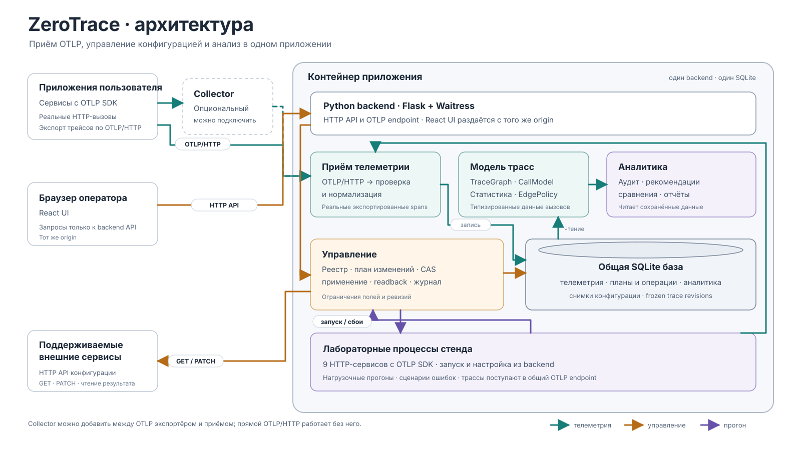

# ZeroTrace

ZeroTrace помогает разобраться, почему HTTP-запрос между сервисами завершился
ошибкой или долго выполнялся, и проверить, как на него влияют повторы и таймауты.
Система принимает OpenTelemetry-трейсы, показывает цепочку вызовов, объясняет
найденные проблемы числами и позволяет проверить поддерживаемые изменения
в лаборатории с реальными HTTP-сервисами.

## Что можно сделать

- Открыть трейс, дерево вызовов и временную шкалу; перейти к графу сервисов.
- Проверить retry/timeout-политики и увидеть основания рекомендаций, источник
  настроек и ограничения данных.
- Прочитать конфиг зарегистрированного сервиса и изменить разрешённые поля
  через план, подтверждение и проверку фактически записанных значений.
- Создать лабораторный стенд, задать задержки и ошибки, выполнить нагрузку
  с seed и сравнить зафиксированные прогоны до и после изменения.
- Исследовать прогноз ускорения выбранных веток и сравнить группы трейсов.
  Прогноз в браузере — расчётная модель; измерения получают отдельным прогоном.

## Быстрый запуск

Нужны **Docker с Compose v2**, Git и свободный локальный порт **8000**.
При первой сборке нужен доступ к реестрам образов и пакетов. Python,
OpenTelemetry и Node.js на хост устанавливать не требуется.

```sh
git clone https://github.com/HamzaAgaev/zerotrace.git
cd zerotrace
docker compose --profile demo up --build -d
```

Откройте **http://127.0.0.1:8000**. Профиль `demo` запускает сервер и UI,
девять приложений примера и генератор трафика. Для эксперимента откройте
«Лабораторию» и создайте стенд оформления заказа.

```sh
docker compose --profile demo ps     # состояние контейнеров
docker compose --profile demo stop   # остановка с сохранением данных
```

Без внешней демонстрационной системы: `docker compose up --build -d`.
Трейсы собственных приложений подключаются через OTLP/HTTP.

[Полная инструкция сборки и запуска](docs/guides/getting-started.md) ·
[Сценарий демонстрации](docs/guides/demo-checklist.md)

## Архитектура



Один Python-сервер объединяет приём телеметрии, SQLite-хранилище, модель трасс,
аналитику и управление. React-приложение обращается к HTTP API того же сервера.
Лабораторные сервисы выполняют реальные HTTP-запросы и отправляют телеметрию
в тот же OTLP-приёмник.

[Интерактивная схема HTML](docs/architecture/overview.html) ·
[Устройство модулей](docs/architecture/components.md)

## Возможности и границы

Подключаемые приложения должны экспортировать OTLP: автоматическая установка
агента и eBPF-сборщик в поставку не входят. Для изменения настроек нужен
совместимый HTTP-адаптер сервиса и разрешения в реестре. Применение рекомендаций
доступно в лаборатории; ручные разрешённые правки внешнего сервиса — отдельно.

Готовый checkout поддерживает ветвления, а генератор стенда из выбранного трейса
пока поддерживает линейную цепочку. Локальная модель ускорения не доказывает
эффект на работающей системе. Настроенные политики и наблюдаемые значения
показываются с указанием их происхождения.

[Подробно о возможностях и ограничениях](docs/guides/capabilities.md)

## Структура репозитория

| Каталог | Назначение |
|---|---|
| `backend/` | Python: телеметрия, граф, аналитика, управление, тесты и fixtures |
| `frontend/` | React/TypeScript/Vite: интерфейс и клиент HTTP API |
| `stand/` | Исполнитель HTTP-сервисов, сценарии и тесты стенда |
| `deploy/` | Настройки Compose-примера, зависимости и генератор нагрузки |
| `docs/` | Архитектура, руководства, API и требования |

[Документация](docs/README.md) ·
[Подключение приложений и API управления](docs/guides/operations.md) ·
[Разработка и тесты](docs/development/testing.md)
