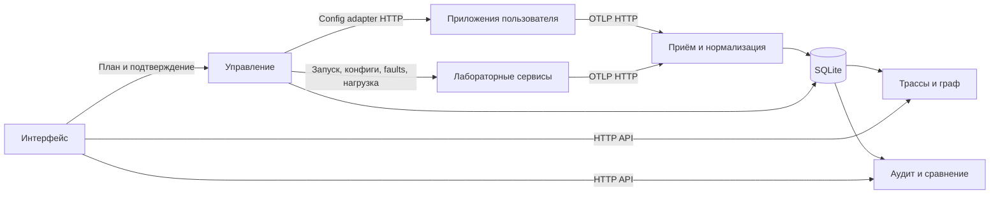

# Компоненты и структура кода

## Исполнение

ZeroTrace — один Python HTTP-сервер и React-приложение с того же origin.
Пользователь запускает собственные приложения и настраивает OTLP exporter.
Лабораторные процессы запускает модуль управления. Collector может находиться
между экспортёрами и сервером; для прямого OTLP HTTP-подключения он не требуется.

## Границы модулей

| Область | Код | Ответственность |
|---|---|---|
| Общий сервер | `backend/app/server/` | Сборка HTTP-приложения, lifecycle и раздача UI |
| A: управление | `backend/app/control/`, `backend/app/integrations/` | Реестр источников, адаптеры, планы, применение, журнал, лаборатория и прогоны |
| B: данные | `backend/contracts/`, `ingest/`, `repository/`, `core/`, `app/data_api/`, `app/otlp_api/` | OTLP, нормализация, хранение, модели графа и API трасс |
| C: аналитика | `backend/app/analytics_api/`, `app/reports/`, `rules/`, `comparison/`, `projection/`, `evalkit/` | Правила, рекомендации, расчёты и отчёты |
| D: интерфейс | `frontend/src/` | Отображение данных и отправка действий оператора |
| Тестовые приложения | `stand/` | Реальный HTTP, instrumentation, управляемые политики и исполнение сценариев |

Все серверные импорты разрешаются от `backend/`: `app`, `contracts`, `core`
и остальные пакеты имеют единственное расположение. Корень репозитория нужен
в Python path для отдельного пакета `stand`. Дублирующего пакета `app` нет.

`backend/app/analytics_api/facade.py` адаптирует модели B и снимки A к расчётам C.
Аналитика читает сохранённые данные и не запускает нагрузку или конфигурационные
изменения. UI отправляет изменение в A, затем отображает состояние операции.

## Хранение и идентичность

B хранит телеметрию в SQLite. A использует `control_records` в том же файле
для планов, операций, настроек и прогонов; C сохраняет артефакты через этот
же механизм. Режим WAL позволяет принимать телеметрию во время чтения.

Токен экспортёра определяет source и environment. Project хранилища включает
окружение, чтобы одинаковые trace ID из разных окружений не смешивались.
Управляющий адрес задаётся отдельно в реестре, а не извлекается из трассы.
Неоднозначное имя сервиса в нескольких namespaces блокирует управление.

`frozen_trace_revisions` содержит точные metadata/spans выбранных ревизий
прогона. Поздняя телеметрия обновляет текущую трассу, но не входы сохранённого
сравнения. `SpanView.target` позволяет отобразить адресата CLIENT-спана,
когда парного SERVER-спана нет; он не предоставляет права управления.

## Структура тестов и данных

Тесты данных B находятся в `backend/tests/test_*.py`, управления —
в `backend/tests/control/`, аналитики — в `backend/tests/analytics/`,
общие проверки HTTP и процессов — в `backend/tests/integration/`.
Исполнитель стенда имеет отдельные `stand/tests/` и `stand/scenarios/`.
Контрактные и аналитические примеры находятся в `backend/fixtures/`.

Результаты локальных прогонов, базы, токены, скриншоты, отчёты сессий
и персональные передачи работы в исходный код не входят.
