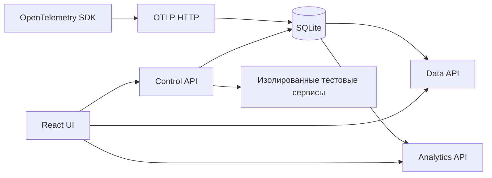

# Руководство разработчика ZeroTrace

## Запуск и настройка

Полная система из корня репозитория:

```sh
docker compose up --build
# С внешней демонстрационной системой и генератором нагрузки:
docker compose --profile demo up --build
```

Приложение и API: `http://127.0.0.1:8000`. Окружение по умолчанию — `shop`.
Стенд создаётся из UI; изменения конфигурации ограничены разрешениями API.

Для разработки интерфейса нужны Node.js 22 и npm:

```sh
cd frontend
npm ci
npm run dev
```

Vite слушает `http://127.0.0.1:5173`. Для работы без backend откройте
«Настройки подключения» → «Открыть демоданные». Для live укажите адрес API
и окружение. Vite не проксирует API: отдельному серверу нужна разрешённая
CORS-конфигурация. В production backend раздаёт `frontend/dist` с того же origin.
Смотрите [настройку сервера и OTLP](../guides/operations.md),
[compose.yaml](../../compose.yaml) и [контракт API](../../frontend/API.md).

## Архитектура



- `backend/app/server` собирает HTTP-сервер и раздаёт интерфейс.
- `backend/contracts`, `ingest`, `repository`, `core` отвечают за телеметрию и хранение.
- `backend/app/analytics_api`, `rules`, `projection` вычисляют аудит и рекомендации.
- `backend/app/control` управляет планами, конфигурациями, журналом и стендом.
- `stand` исполняет тестовые HTTP-сервисы.
- `frontend/src/api/client.ts` реализует общий `Client` для live и demo. UI не исполняет правила аудита и не обращается напрямую к управляющим API сервисов.

Подробности: [границы модулей](../architecture/components.md),
[конфигурация и лаборатория](../architecture/configuration-and-lab.md).

## Страницы и состояние

`App.tsx` связывает подключение, hash-навигацию и загрузку данных.
`lib.ts/readRoute` сохраняет совместимость старых ссылок. Корневой адрес
по-прежнему открывает трейсы; лендинг доступен по `#/home`, руководство — `#/guide`.

| Маршрут | Экран |
|---|---|
| `#/traces` | Список, поиск, фильтры, сводка системы |
| `#/traces/:id` | Трейс, спаны, аудит, JSON-экспорт |
| `#/services` | Граф, инспектор и настройки сервисов |
| `#/services?tab=statistics` | Статистика сервиса и эндпоинта |
| `#/audit` | Проблемы, проверки, история изменений |
| `#/lab` | Сценарий, стенд, конфигурация, нагрузка |
| `#/lab?run=:id` | Результат запуска и его трейсы |
| `#/sources` | Live/demo и параметры подключения |
| `#/home`, `#/guide` | Презентация продукта и инструкции |

`state.tsx` и `storage.ts` сохраняют фильтры, вкладки и черновики по подключению
и окружению. `ViewMemory` восстанавливает прокрутку и раскрытые элементы;
восстановление состояния не выполняет запросов на изменение конфигурации.
Идентичность трейса включает окружение, generation и revision: не заменяйте
полную ссылку одним trace ID при запросах аудита или переходах.

## Общие компоненты и визуальные правила

[Дизайн-система](design-system.md) описывает роли, токены и исключения.
Страница отвечает за композицию, компонент — за внешний вид и поведение:

| Компонент | Когда использовать |
|---|---|
| `PageHeader`, `Panel` | Заголовок страницы и блока |
| `Input`, `Field`, `SearchField` | Нативное поле, подпись и поиск с иконкой |
| `Select`, `PeriodSelect` | Доступный список и единый выбор периода |
| `Button`, `LinkButton`, `BackLink`, `RetryButton` | Действие, переход, возврат и повтор |
| `Tabs` | Переключение связанных представлений с клавиатуры |
| `TableScroll`, `TraceTable` | Горизонтальная прокрутка и общая таблица запросов |
| `Metrics`, `MetricLabel` | Метрики и справка |
| `StatisticsCharts`, `RunCharts` | Общие графики, легенды и детали измерений |
| `ServiceGraph`, `ServiceConfig` | Схема и редактор настроек |
| `Message`, `EmptyState`, `LoadingState` | Ошибка, отсутствие данных и загрузка |

`Button` обрабатывает Promise, предотвращает повторный запуск и показывает
ошибку; возвращайте Promise из `onClick`, если действие асинхронное.
`Input` передаёт нативные props и ref; не заменяйте валидацию браузера div-элементами.
`Select` поддерживает множественный выбор, стрелки, Home/End, Escape и поиск
по первым буквам. Его popup вынесен в portal, чтобы панели не обрезали список.

## Документация и скриншоты

Источник пользовательских инструкций — `frontend/src/views/guide-content.json`.
Он используется страницей `Guide` и генератором Markdown:

```sh
cd frontend
npm run docs
npm run docs:check
```

Скриншоты итогового UI хранятся в `frontend/public/guide/*.jpg` и входят
в production build. Снимайте их на демоданных без персональных данных;
после визуальных изменений обновляйте соответствующие файлы. Ссылка из
руководства открывает оригинал изображения для увеличения. Не используйте
скриншоты ошибки загрузки вместо реального экрана.

## Проверки перед изменением и выпуском

```sh
cd frontend
npm test
npm run build
npm run docs:check
```

Проверьте 1440 px и 390 px (также границу 760 px): все маршруты, фильтры,
фокус клавиатуры, списки, горизонтальную прокрутку, диалог плана и состояния
загрузки/ошибки/пустого результата. В графиках проверьте детали по наведению,
клавиатуре и нажатию. Не уменьшайте шрифт ради помещения широкой таблицы.

Backend и стенд: [команды проверок](../development/testing.md).
Отдельный live smoke test нужен для OTLP, разрешений, записи конфигурации,
конфликтов версий и настоящей нагрузки — demo этого не проверяет.

Текущие ограничения: граф строится по ограниченной выборке; демотесты
иллюстративны; автоматического экрана сравнения двух прогонов сейчас нет.
Существующие серверные контракты сравнения не означают наличие такой кнопки в UI.

[Результаты проверки интерфейса](ui-verification.md).
