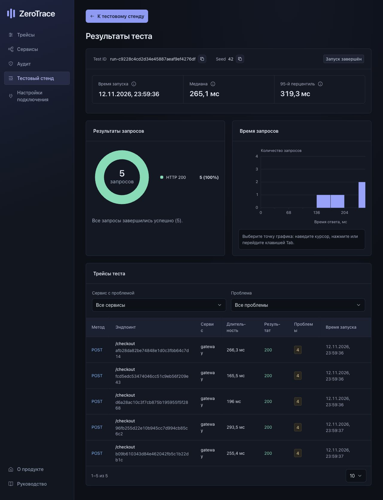

# Проверка с реальным backend — 12–13 ноября 2026

Проверена локальная Docker Compose сборка на `http://127.0.0.1:8000`.
Интерфейс работал в live-режиме, запросы выполнялись настоящими HTTP-сервисами,
трейсы поступали по OTLP. Исходные сервисы и данные окружения `shop` сохранены.

## Проверенные сценарии

- Подключение к backend, выбор `shop`, загрузка списка и полного трейса
  `48ad43aa43fe32a2fc8f82a42e901571` (9 сервисов, HTTP 200), временная шкала.
- Аудит отдельного трейса и всего окружения, получение результатов асинхронного аудита.
- Создание из интерфейса изолированного стенда «Магазин» с 9 сервисами.
- Изменение `orders → payment`, `charge-payment`: таймаут 250 → 300 мс,
  число попыток 3 → 2. Backend подтвердил revision 2; журнал:
  `op-e4dbac2f2ab648bd80bf46ca3be45ece`, статус `applied`.
- Ошибка `payment POST /charge`: вероятность 100%, HTTP 503, до downstream-вызовов.
  Прогон `run-5ed09883b6304df18948612fc624d220`: 5 запросов, concurrency 1,
  seed 42; все 5 получили HTTP 503, все 5 трейсов собраны.
- Отключение ошибок и контрольный прогон `run-c9228c4cd2d34e45887aeaf9ef4276df`:
  те же параметры, 5 из 5 HTTP 200, все 5 трейсов собраны.
- Остановка созданного стенда из интерфейса. Результаты сохранены и доступны
  после пересоздания контейнера приложения; существующие сервисы `shop` работают.

## Исправление

R7 ошибочно сравнивал HTTP 503 с буквальным токеном `5xx` и сообщал о
недопустимом повторе. Теперь правило распознаёт классы `4xx` и `5xx`, сохраняя
точное сравнение кодов и отдельную семантику gRPC. Версия правил — `1.1.2`.
Добавлены регрессии для границ классов, точных кодов, словаря по протоколам,
пустой политики и несовпадающих условий; обновлены эталонные ответы.

На сохранённом реальном аварийном прогоне после исправления остались
`R4`, `R6`, `OBS_RETRIES`; ложный R7 исчез. В успешном прогоне остаются
предупреждения о бюджетах `R4` и `R8`: HTTP 200 не означает отсутствие
рисков в конфигурации таймаутов.

## Автоматические проверки

- `backend/tests` и `stand/tests`: **455 passed, 117 subtests passed**.
- Отдельно live integration: control, restart, scenario paths — **10 passed**.
- Frontend при сборке образа: **57 tests passed**, production build успешен.
- `git diff --check`: успешно.

При пересборке Compose возник конфликт имени контейнера; контейнер приложения
пересоздан без удаления томов. После запуска проверены версия правил и аудит
обоих сохранённых прогонов: по 5 проанализированных трейсов, 0 отсутствующих.

Проверка выполнялась локально. Удалённый production, iOS Safari и Android Chrome
не проверялись. Скриншоты пользовательского руководства по-прежнему демонстрационные.
