# Руководство пользователя ZeroTrace

Пошаговые сценарии текущего приложения. Иллюстрации обновлены 13 ноября 2026 года после редизайна. Скриншоты сняты в формате ноутбука 1440 × 900, без масштабирования и ручной обрезки, с демонстрационными данными; HTTP-нагрузка в этом режиме не выполняется. Это же руководство доступно в приложении по ссылке `#/guide`.

## Начало работы: главная страница

1. Откройте корневой адрес приложения: главная страница знакомит с возможностями ZeroTrace без бокового меню.
2. Нажмите «Открыть приложение», чтобы перейти к трейсам. Кнопка «Попробовать на примере» ведёт к выбору демонстрационных данных.
3. Технические подробности раскрываются в разделе «А что внутри?». Переходы между секциями при прокрутке и переливы фона можно отключить кнопкой вверху страницы; системная настройка уменьшения движения отключает её автоматически.
4. В приложении логотип ZeroTrace ведёт к трейсам, а пункт «О продукте» возвращает на главную.

## 1. Подключение и демонстрационный режим

1. Откройте «Настройки подключения» в навигации.
2. Для знакомства без сервера нажмите «Открыть демоданные». Изменения в этом режиме локальные, HTTP-нагрузка не выполняется.
3. Для реальной системы укажите адрес сервера ZeroTrace и окружение (например, shop), затем нажмите «Проверить и подключить». При ошибке прежнее подключение сохраняется.
4. Проверьте блок «Текущее подключение». Разрешение на изменение конфигурации определяется сервером; выбранный режим live сам по себе не подтверждает доступность сервера.
5. Чтобы увидеть реальные трейсы, приложение должно отправлять OTLP в ZeroTrace. Настройка экспорта описана в docs/guides/operations.md репозитория.

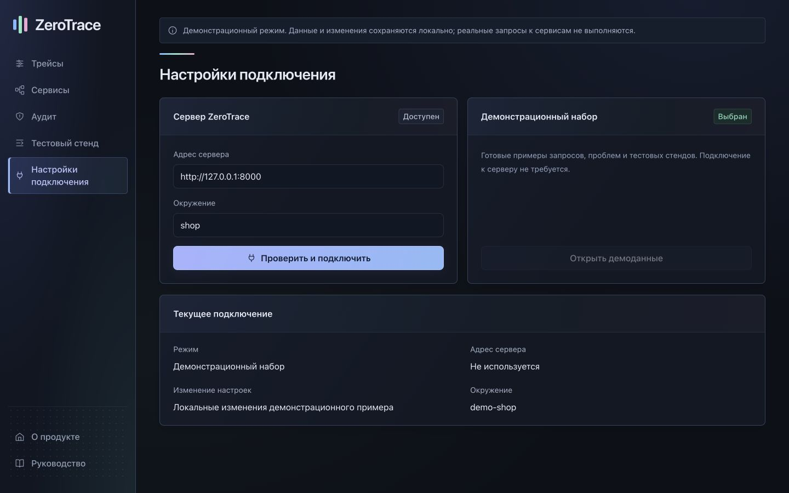

## 2. Найти нужный запрос

1. Откройте «Трейсы». Нажмите «Показать статистику системы» и выберите период в раскрытой сводке.
2. Введите эндпоинт, сервис или Trace ID в строку поиска. Выберите сервисы, методы, результаты или проблемы аудита в фильтрах. Можно выбрать несколько значений.
3. Для точного поиска укажите Span ID из 16 шестнадцатеричных символов. При необходимости задайте начало и конец периода в часовом поясе браузера и нажмите «Применить».
4. Выберите сортировку: новые или медленные запросы. Переходите между страницами и меняйте количество строк; «Сбросить» очищает фильтры.
5. Нажмите на запрос в таблице, чтобы открыть его. На телефоне прокрутите таблицу вправо для остальных столбцов.

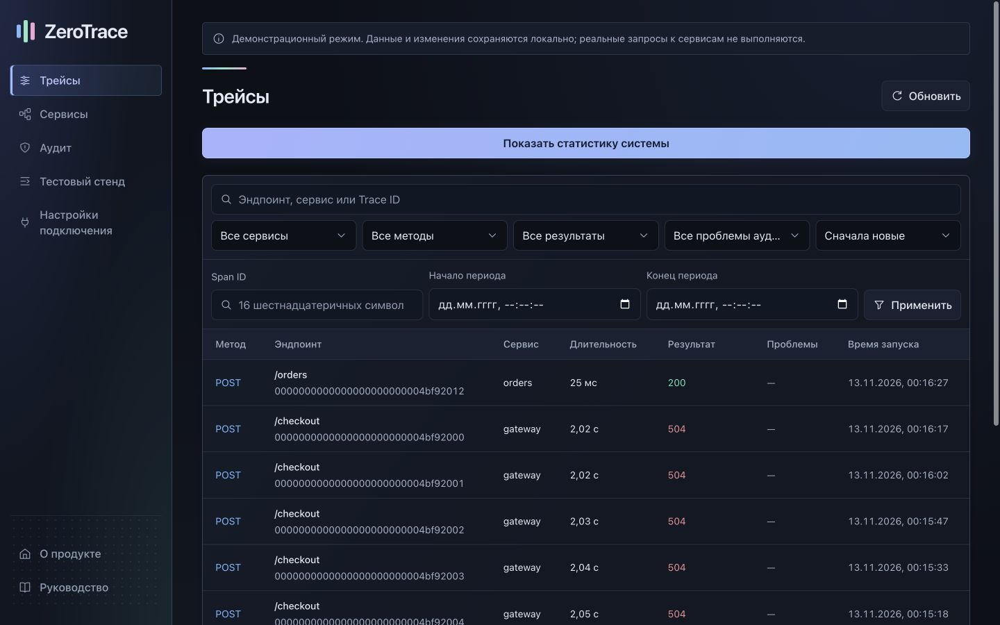

## 3. Разобрать трейс и выгрузить отчёт

1. На вкладке «Выполнение» просмотрите длительность запроса и дерево вызовов. Цвет сервиса одинаков на графе и в трейсах.
2. Нажмите спан, чтобы увидеть его данные справа (на телефоне — ниже). Раскрывайте вложенные вызовы, меняйте масштаб шкалы, используйте «Развернуть всё», если часть ветвей скрыта.
3. Перейдите на вкладку «Аудит», чтобы увидеть проблемы этого трейса и примеры. Сообщение о нехватке данных не означает отсутствие проблем.
4. Кнопкой рядом с идентификатором скопируйте его. Кнопка «JSON-отчёт» скачивает трейс и доступный аудит; демоотчёт помечен как демонстрационный.
5. Вернитесь к списку через кнопку возврата. Фильтры и выбор сохраняются в браузере отдельно для подключения и окружения.

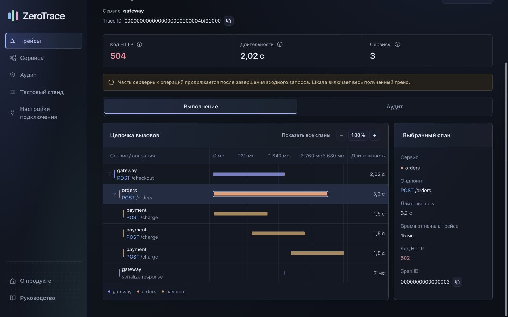

## 4. Исследовать связи сервисов

1. Откройте «Сервисы» и вкладку «Граф». Выберите период и при необходимости включите «Только проблемные связи».
2. Перемещайте и масштабируйте схему её элементами управления. Нажмите узел для данных сервиса или связь для показателей вызова.
3. Изучите количество вызовов, ошибки и время ответа в инспекторе. Настройки исходящего вызова находятся у вызывающего сервиса.
4. Учитывайте предупреждения о неполной выборке. Граф показывает загруженные данные, а внешний адресат без спана обработки не равен отсутствующему сервису.

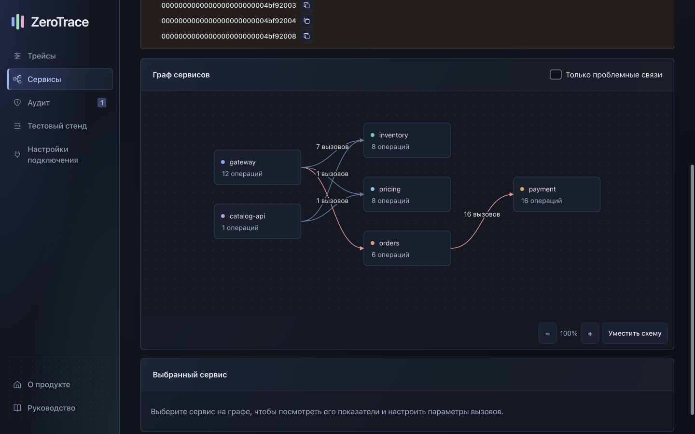

## 5. Прочитать статистику системы

1. Для общей динамики откройте «Трейсы» → «Показать статистику системы». Для отдельного сервиса откройте «Сервисы» → «Статистика». Выберите период наблюдения.
2. Сопоставьте число запросов, ошибки и перцентили. Кнопка информации возле метрики объясняет её смысл.
3. На графиках наведите курсор, нажмите точку или перейдите к ней клавишей Tab: подробности появятся в одинаковом блоке под графиком.
4. На небольшом экране прокрутите график горизонтально: размер подписей сохраняется. Распределение показывает интервалы времени ответа и число запросов в них.
5. Выберите сервис и эндпоинт в доступных фильтрах, чтобы сузить статистику. Пустое состояние или предупреждение сообщает, когда измерений недостаточно.

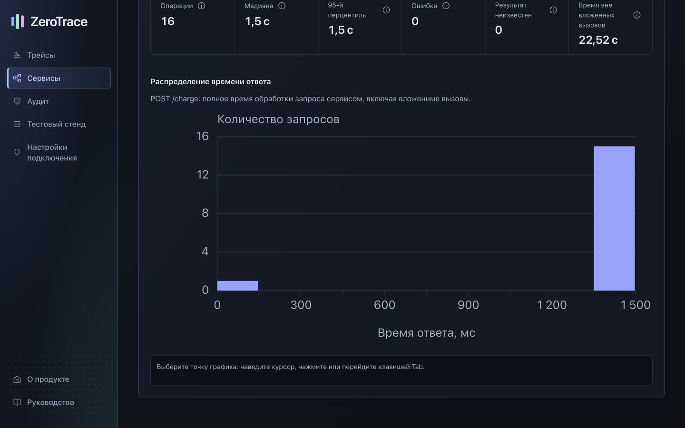

## 6. Проверить рекомендацию и план

1. Откройте «Аудит» → «Проблемы». Прочитайте объяснение, влияние, предлагаемое изменение и ограничения.
2. Перейдите по примеру трейса для проверки фактического поведения. На вкладке «Проверки» видны выполненные проверки и причины, по которым другие недоступны.
3. Если рекомендация поддерживает изменение, откройте план. Сравните текущие и предлагаемые значения, область изменения и условия проверки.
4. Применение доступно только при разрешении сервера и соответствующем окружении. Подтвердите действие в диалоге, если оно подходит; закрытие диалога ничего не применяет.
5. Если рекомендация устарела, обновите аудит и заново откройте план. При конфликте конфигурации проверьте текущие серверные значения перед повтором.
6. Откройте «История изменений», чтобы проверить результат и подробности записи. Не принимайте предварительный план за уже применённое изменение.

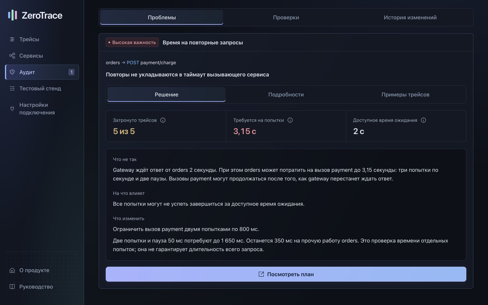

## 7. Создать тестовый стенд

1. Откройте «Тестовый стенд». Нажмите «Создать пример магазина» для встроенного сценария.
2. Для своей топологии скачайте пример JSON, измените сервисы и вызовы, затем нажмите «Загрузить JSON» (до 1 МБ). Дождитесь проверки, изучите предпросмотр и нажмите «Создать стенд».
3. Дождитесь готовности стенда. При ошибке прочитайте сообщение и обновите состояние. Схема показывает созданные мок-сервисы.
4. Выберите сервис на схеме или в списке, затем нужный эндпоинт. После остановки стенда запуск нагрузки недоступен.

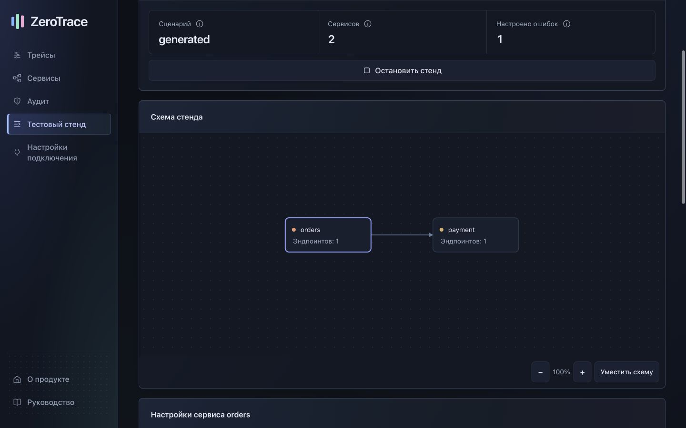

## 8. Настроить задержки, повторы и ошибки

1. На стенде выберите сервис и вкладку «Задержка сервиса». Задайте фиксированное время или параметры доступного распределения и сохраните разрешённые изменения.
2. На вкладке «Таймауты и повторы» выберите исходящий вызов. Укажите таймаут попытки, общее число попыток (включая первую), паузу и условия повтора. Поля без права записи доступны только для чтения.
3. На вкладке «Имитация ошибок» выберите эндпоинт, вероятность, код HTTP, дополнительную задержку и этап обработки. Для случайного выбора отметьте хотя бы один этап.
4. Нажмите «Сохранить настройки ошибок». Для чистого эксперимента используйте «Отключить ошибки на стенде».
5. Во время запуска часть управления заблокирована. Дождитесь завершения; при конфликте версии проверьте актуальные значения. Черновик в браузере сам по себе ничего не меняет на сервере.

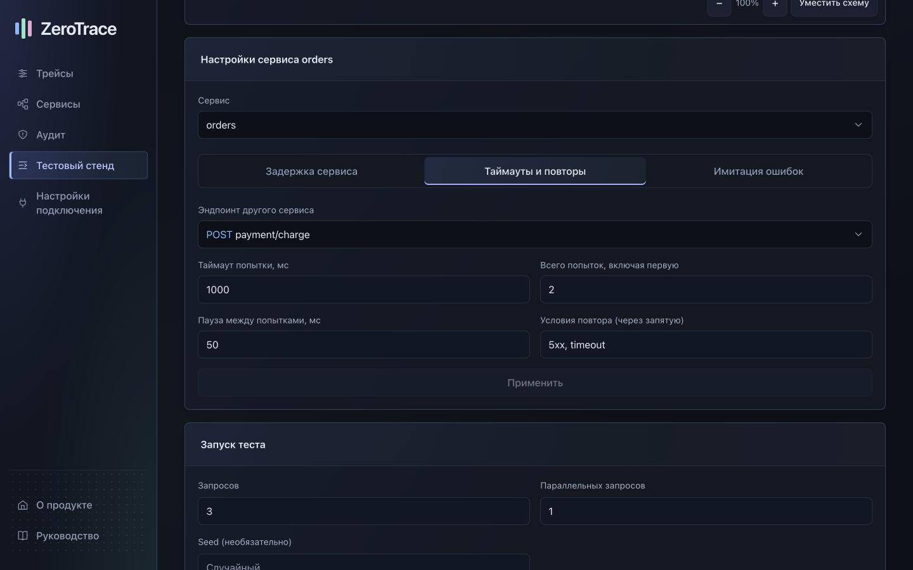

## 9. Запустить тест и исследовать результат

1. В блоке «Запуск теста» задайте число запросов (1–1000), параллельность (1–32) и при необходимости неотрицательный целочисленный Seed.
2. Нажмите «Запустить тест». При неопределённом исходе используйте предложенный повтор запроса запуска. Не создавайте дублирующую нагрузку.
3. Откройте запуск в таблице «Результаты тестов». Проверьте состояние, распределение ответов, время выполнения и доступные трейсы.
4. Отфильтруйте трейсы теста по сервису с проблемой и проблеме аудита. Откройте трейс для подробного расследования.
5. Для эксперимента «до/после» сохраните параметры первого запуска, измените настройки и выполните второй с теми же нагрузкой и Seed. Откройте оба результата и сопоставьте показатели; отдельного экрана автоматического сравнения сейчас нет.
6. После эксперимента вернитесь к стенду и нажмите «Остановить стенд». История результатов остаётся доступной. В демонстрационном режиме результаты иллюстративны.

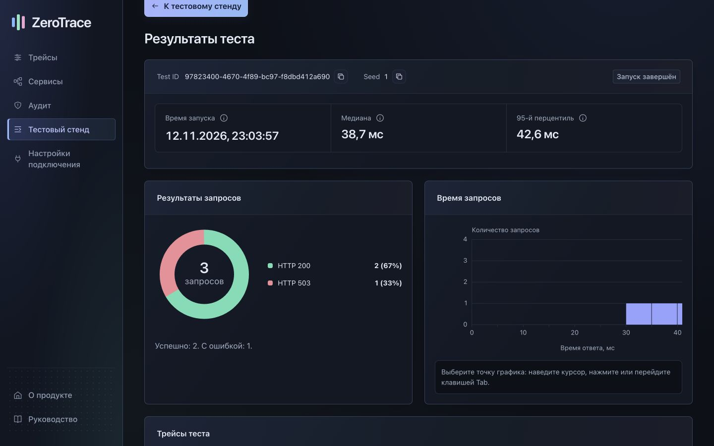

## 10. Мобильный экран, клавиатура и восстановление

1. На телефоне разделы доступны в верхней навигации; формы расположены в одну колонку. Таблицы и графики прокручиваются внутри своего блока.
2. Клавишей Tab переходите между элементами; в списках и вкладках используйте стрелки, Home и End, Escape закрывает список. Enter подтверждает выбранное действие.
3. После ошибки загрузки нажмите «Повторить» или «Обновить». Если остаются старые данные, интерфейс сообщает об этом.
4. При отсутствии данных проверьте период, фильтры, адрес сервера и окружение. Для проверки интерфейса без сервера переключитесь на демоданные.
5. Настройки интерфейса хранятся локально. Смена подключения или окружения открывает отдельное сохранённое состояние; очистка данных сайта сбросит его.

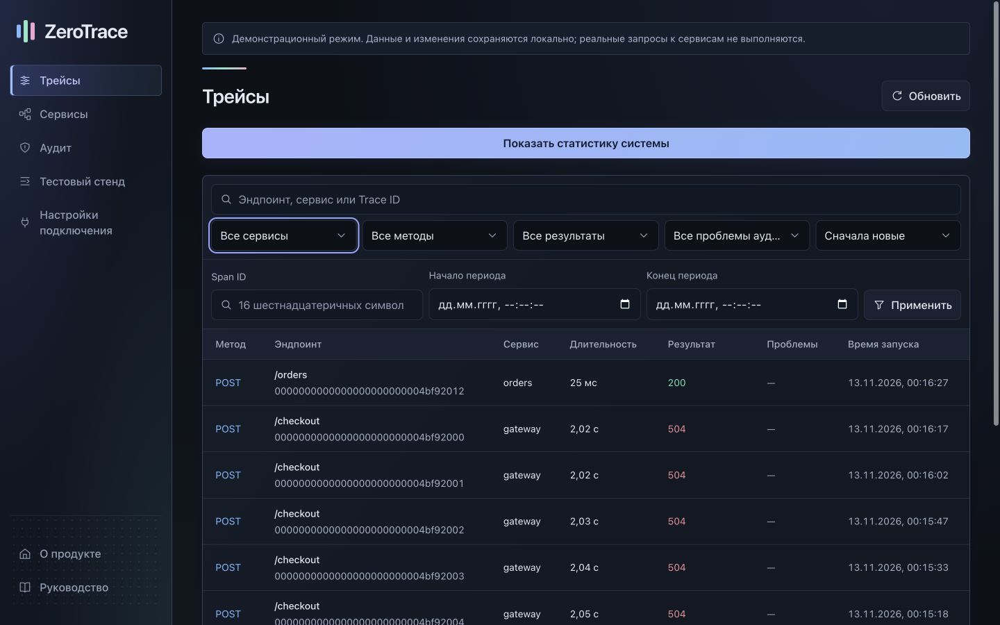

## Дополнительные экраны

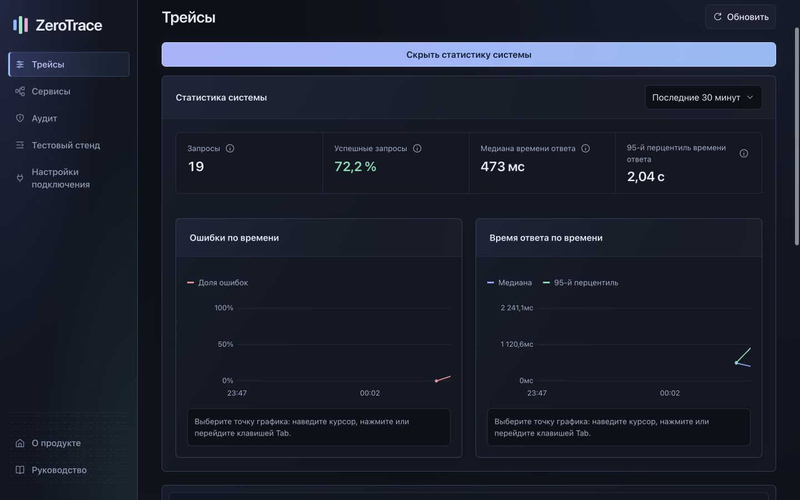

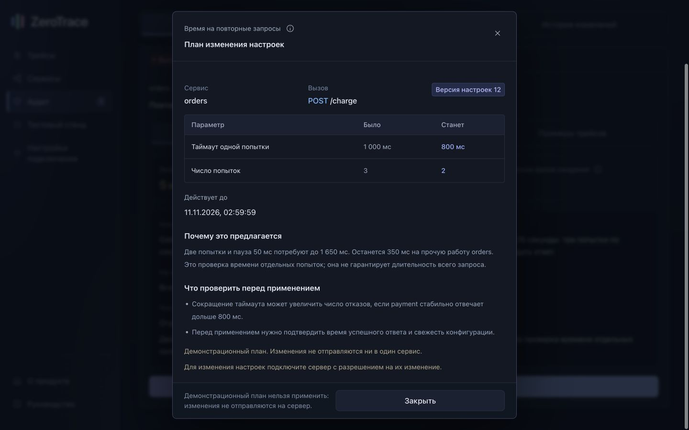

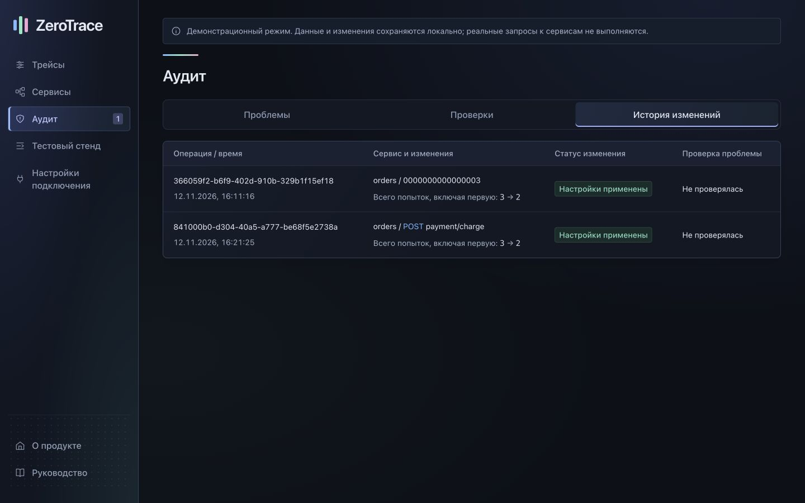

[Подключение OTLP](../guides/operations.md) · [Формат JSON-сценария](../guides/lab-scenario.md) · [Документация разработчика](../developers/README.md)
